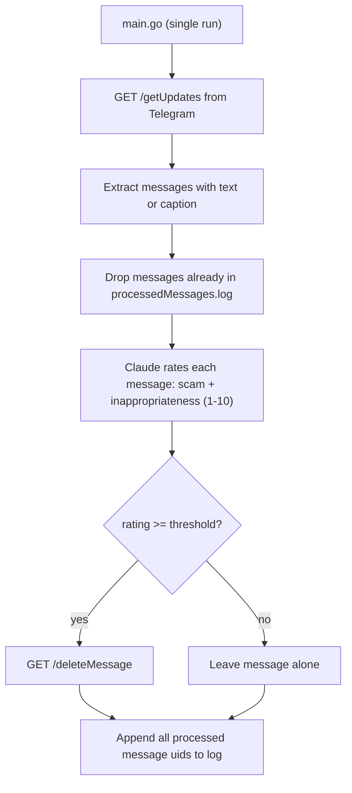

# **MiniChatSentryBot** : <small>a Golang Telegram Bot</small>

## Table of Contents
1. [About the Project](#1-about-the-project-github-repository)
2. [What Can It Do?](#2-what-can-it-do)
3. [How Does the Code Work?](#3-how-does-the-code-work)
    - 3.1. [Implementation in Go](#31-implementation-in-go)
        - [Design goals](#design-goals)
        - [Project structure](#project-structure)
        - [How an `[automod]` run flows](#how-an-automod-run-flows)
        - [Go techniques used](#go-techniques-used)
        - [Configuration](#configuration)
        - [What I learned](#what-i-learned)
4. [Can I Just Invite This Bot into My Telegram Group?](#4-can-i-just-invite-this-bot-into-my-telegram-group)
    - 4.1. [NO](#41-no)
5. [Other Documents](#5-other-documents)

## 1. About the Project ([Github Repository](https://github.com/jrenjq/MiniChatSentryBot))
- This is a Telegram Bot, programmable to perform admin tasks.
- Written in Golang, aims to be stateless (e.g. no need database etc) and deploy-anywhere (with internet).
- Originally developed to manage a university Telegram group.

## 2. What Can It Do?
- `v0.2`: Deletes scam and inappropriate messages using Claude3.5 Sonnet API. `[automod]`

- `v0.1`: **[[CURRENTLY DEFUNCT due to undocumented Telegram Bot API changes, which removes reactions from update responses]]** the bot finds messages with **3 or more** counts of "👎" reactions, and **deletes that message** `[downvote]`


## 3. How Does the Code Work?
First and foremost, take a gander at the [Telegram Bot documentation](https://core.telegram.org/bots).
1. on Telegram: 
    - create a bot with `@BotFather`
    - invite bot into group as admin who can access messages
    - bot has its own URL on the Telegram server (see [`API_REFERENCE`](API_REFERENCE.md))
2. in your code: 
    - bot calls its URL with a path for what information it wants (eg. `/getUpdates`)
    - bot gets that information from Telegram as a HTTP response
3. in your code: 
    - bot does something in response to the HTTP response (e.g. delete a message)
    - bot waits a while before calling its URL again *(goto step 2)*.
  
### 3.1. Implementation in Go

#### Design goals
- **Stateless and deploy-anywhere:** one compiled binary, plain-text config, no database or web server.
- **One pass per run:** the program fetches updates, acts on them, and exits. Run it on a schedule (cron, systemd timer, etc.).
- **Features are toggled by config, not code:** turn `[downvote]` and `[automod]` on or off in `.conf` without rebuilding.

#### Project structure
```
code/
├── main.go     # entrypoint: wires the features together
├── top/        # feature-level orchestration (one file per feature)
├── repo/       # "get X / do Y" functions that talk to Telegram, Claude, or files
├── structs/    # types that JSON responses are decoded into
└── utils/      # generic helpers: HTTP, env loading, file append, counting
```
Dependencies flow one way: `main → top → repo → utils/structs`. Each feature in `top/` reads like a recipe, and the details live in `repo/` and `utils/`.

#### How an `[automod]` run flows


#### Go techniques used
**1. Typed JSON decoding.** Go needs a struct for every JSON shape, so `structs/` mirrors Telegram's and Claude's responses. A single helper, `utils.Http_GET_JSON`, takes a URI and a pointer to any struct (`interface{}`) and decodes the response straight into it with `json.NewDecoder`, so every Telegram call reuses it.

**2. Config from the environment.** Secrets and endpoints live in `.env`, and feature switches and thresholds live in `.conf`. Both are loaded with `godotenv`, and a missing key fails fast with a clear error.

**3. Structured output from an LLM.** The system prompt makes Claude reply in a fixed `(A)(B):(X)(Y)` format: scam rating, inappropriateness rating, then a short reason for each. A regex pulls the parts out into a struct:
```go
re := regexp.MustCompile(`\((.*?)\)`)
matches := re.FindAllStringSubmatch(claude_rating_string, -1)
scam_rating_int, _ := strconv.Atoi(matches[0][1])
```
A message goes on the "naughty list" if either rating meets its configured threshold (`SCAM_RATING_GTE`, `INAPPROPRIATE_RATING_GTE`).

**4. Calling the Claude API with plain `net/http`.** There's no SDK. The request is a `ClaudePayload` struct encoded to JSON, sent as a POST with `x-api-key` and `anthropic-version` headers, using an `http.Client` with a timeout.

**5. Statelessness without a database.** Telegram keeps showing the bot recent messages, including ones it already deleted. To avoid re-rating them, every processed message gets a unique id (`chat_id:message_id`), appended to `processedMessages.log`. On the next run the log is loaded into a set and used to skip those messages:
```go
alr_processed_msgs_set := make(map[string]struct{})
for _, del_msg := range *previously_deleted_messages {
    alr_processed_msgs_set[del_msg] = struct{}{}
}
```
A `map[string]struct{}` gives O(1) lookups and the empty struct costs no memory.

#### Configuration
| File | Key | Purpose |
|---|---|---|
| `.conf` | `GPT_REVIEW_FEATURE_ON` | turn `[automod]` on or off |
| `.conf` | `SCAM_RATING_GTE` / `INAPPROPRIATE_RATING_GTE` | deletion thresholds (1-10) |
| `.conf` | `*_DEBUG_MODE` | verbose logging per feature |
| `.env` | `BOT_TOKEN`, `CLAUDE_API_KEY`, endpoint paths | secrets and URLs (git-ignored) |
| `claude/prompts/systemPrompt.txt` | system prompt | kept private so spammers can't tailor messages to it |

#### What I learned
See [`DEVLOG` → Food For Thought](DEVLOG.md#3-food-for-thought) for notes on why Go needs structs for JSON, structs vs. maps, and flattening unique struct fields into strings to simplify comparisons.

## 4. Can I Just Invite This Bot into My Telegram Group?
### 4.1. NO 
You should **CREATE YOUR OWN BOT** via Telegram's @BotFather, get your own **BOT API TOKEN**, and host the code online to manage this bot (if you really want to).

You could invite this bot as an existing instance on Telegram into your own Telegram group. And you will have to make it an admin, where it'll be able to do many, many things indeed.

But you will **HAVE NO CONTROL OVER THE BOT**, because you don't have the **BOT API TOKEN**. Sometimes in the corner of your eye, you see the bot ... twitching ... talking to itself ... mumbling darkly as it does its job.

The bot that is an admin in your group that you can't control. You can't know for sure what it'll do. And people who make Telegram bots rarely pass the opportunity to play tricks on silly folks. 

Don't be a silly folk :) Fork the code and host your own bot.

## 5. Other Documents
- [`API_REFERENCE`](API_REFERENCE.md): APIs used and explanations.
- [`DEVLOG`](DEVLOG.md): work done and tech debt.
- [`SETUP`](SETUP.md): how to setup this project, for development and deployment.
